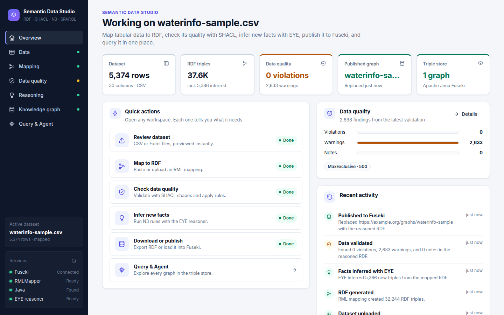
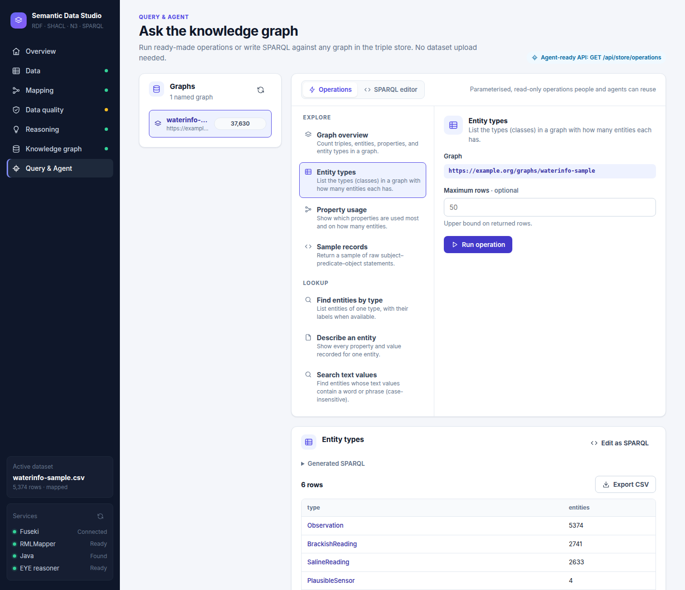
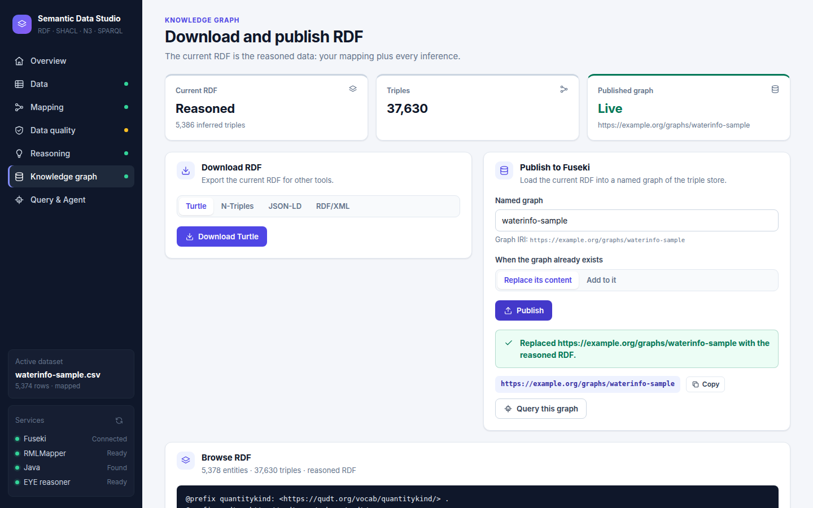
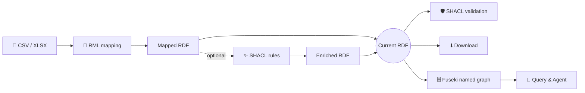

<div align="center">

# 🧭 Semantic Data Studio

**Turn spreadsheets into a validated, queryable knowledge graph, all in one dashboard.**

Upload a CSV or Excel file, map it to RDF with RML, check and enrich it with SHACL,<br>
publish it to Apache Jena Fuseki, and explore it with ready-made queries or SPARQL.

[](https://www.python.org/)
[](https://fastapi.tiangolo.com/)
[](https://react.dev/)
[](https://jena.apache.org/documentation/fuseki2/)
[](https://www.w3.org/TR/shacl/)
[](LICENSE)



[Features](#-features) · [Formats](#-supported-data-formats) · [Installation](#-installation) · [Quick tour](#-quick-tour) · [Agent API](#-query--agent-api) · [Troubleshooting](#-troubleshooting)

</div>

---

## ✨ Features

| | Workspace | What you can do |
| :---: | --- | --- |
| 📊 | **Overview** | See the dataset size, RDF triple count, data quality, published graph, and triple-store status at a glance, with quick actions and recent activity. |
| 📁 | **Data** | Upload `.csv` or `.xlsx` files ([details](#-supported-data-formats)). Preview rows, columns, and the file name your mapping should reference. Multi-row Excel headers and split date/time columns are merged automatically. |
| 🔀 | **Mapping** | **Paste** an RML mapping or **upload** a mapping file, then generate RDF with RMLMapper. Column names and the logical-source name are shown next to the editor. |
| 🛡️ | **Data quality** | **Paste** or **upload** SHACL shapes. **Validate** against SHACL Core and SPARQL-based constraints, with a searchable table of violations, warnings, and notes. **Apply rules** (`sh:TripleRule`, `sh:SPARQLRule`) to enrich the data with inferred facts. |
| 🗄️ | **Knowledge graph** | **Download** the RDF as Turtle, N-Triples, JSON-LD, or RDF/XML. **Publish** it to a Fuseki named graph, replacing or adding to its content. Browse it entity by entity. |
| 🤖 | **Query & Agent** | Query **any graph** in Fuseki, no upload needed. Use ready-made operations (overview, entity types, property usage, search, and more) or write SPARQL, then export results as CSV. The operations are also exposed as an API that AI agents can call as tools. |

You can open the workspaces in any order. Each one says what it needs before it can run.

<table>
  <tr>
    <td width="50%"><p align="center"><b>Data quality:</b> SHACL validation results</p></td>
    <td width="50%"><p align="center"><b>Query &amp; Agent:</b> operations on the triple store</p></td>
  </tr>
  <tr>
    <td colspan="2"><p align="center"><b>Knowledge graph:</b> download, publish, and browse RDF</p></td>
  </tr>
</table>

## 🔄 How it works



The **current RDF** is the enriched RDF when SHACL rules have run, and the mapped RDF otherwise. Validation, downloads, publishing, and the RDF browser all use it.


## 📁 Supported data formats

The **Upload a dataset** option accepts **CSV (`.csv`)** and **Excel (`.xlsx`)** files up to **50 MB** (configurable with `MAX_UPLOAD_BYTES`).

| Format | How it's read |
| --- | --- |
| **`.csv`** | The delimiter is detected automatically (comma, semicolon, tab, or pipe). UTF-8 encoding, with Latin-1 as a fallback. The first row must hold the column names. For tab-separated files, rename `.tsv` to `.csv`. |
| **`.xlsx`** | Only the **active worksheet** is used. Headings spread over several rows are merged into one column name (for example `Ambient temperature \| SENSOR_A \| degC`). A date column directly followed by a time column becomes one `DateTime` column. Formulas use their last calculated values. The sheet is converted to CSV for RMLMapper, so your mapping references `<name>.csv`. |

> [!NOTE]
> Older Excel files (`.xls`), macro-enabled workbooks (`.xlsm`), OpenDocument spreadsheets (`.ods`), JSON, and XML are **not supported**. Save them as `.xlsx` or `.csv` first.

---

## 🚀 Installation

Semantic Data Studio has three parts: this application (a Python backend plus a React frontend), **RMLMapper** for the mapping step, and **Apache Jena Fuseki** as the triple store. You install RMLMapper and Fuseki separately; both are free downloads.

### Prerequisites

| Software | Version | Needed for | Check with |
| --- | --- | --- | --- |
| [Python](https://www.python.org/downloads/) | 3.10 or newer | Backend | `python --version` |
| [Node.js](https://nodejs.org/) (includes npm) | 20.19+ or 22.12+ | Building the dashboard | `node --version` |
| [Java](https://adoptium.net/) | 21 or newer | Running RMLMapper and Fuseki | `java -version` |
| [RMLMapper](https://github.com/RMLio/rmlmapper-java/releases) | latest release | Mapping tabular data to RDF | see step 3 |
| [Apache Jena Fuseki](https://jena.apache.org/download/) | latest release | Storing and querying RDF | see step 4 |

### 1. Get the code

```bash
git clone https://github.com/ShehabEldeenAyman/Generic-Dashboard-System.git
cd Generic-Dashboard-System
git checkout December-2026-Demo
```

### 2. Install the Python dependencies

```bash
pip install -r requirements.txt
```

> [!TIP]
> To keep the project's packages separate from the rest of your system, create a virtual environment first:
> `python -m venv .venv`, then `source .venv/bin/activate` (macOS/Linux) or `.\.venv\Scripts\Activate.ps1` (Windows).

You don't need to install the frontend dependencies by hand. `run.py` runs `npm install` the first time it starts.

### 3. Download and add RMLMapper

> [!IMPORTANT]
> The mapping step needs RMLMapper. It isn't included in the repository because of its size.

1. Open the [RMLMapper releases page](https://github.com/RMLio/rmlmapper-java/releases) and pick the latest release.
2. Under **Assets**, download the file ending in **`-all.jar`** (for example `rmlmapper-8.x.x-r…-all.jar`). This version bundles everything RMLMapper needs.
3. Rename it to **`rmlmapper.jar`** and move it into this repository's **`pipeline/`** folder:

   ```text
   Generic-Dashboard-System/
   └── pipeline/
       └── rmlmapper.jar   ← here
   ```

   On macOS or Linux, once the download has finished:

   ```bash
   mv ~/Downloads/rmlmapper-*-all.jar pipeline/rmlmapper.jar
   ```

The JAR is ignored by Git. To keep it somewhere else, set the `RML_MAPPER_JAR` environment variable to its full path.

### 4. Install and start Apache Jena Fuseki

> [!IMPORTANT]
> Publishing and querying need a running Fuseki server with a dataset named **`dataset`**.

1. Go to the [Apache Jena download page](https://jena.apache.org/download/).
2. Download **`apache-jena-fuseki-<version>.zip`** (or `.tar.gz`).
   Don't download `apache-jena-<version>`; that archive only has command-line tools, not the server.
3. Unzip it anywhere, for example in your home folder.
4. Open a **new terminal**, go into the unzipped folder, and start Fuseki:

   **macOS / Linux**
   ```bash
   cd ~/apache-jena-fuseki-<version>
   ./fuseki-server --update --mem /dataset
   ```

   **Windows (PowerShell)**
   ```powershell
   cd $HOME\apache-jena-fuseki-<version>
   .\fuseki-server.bat --update --mem /dataset
   ```

5. Leave this terminal open; closing it stops Fuseki. Fuseki's own web interface is at <http://localhost:3030>.

`--mem` keeps data in memory, so it's erased when Fuseki stops. To keep your data between restarts, use persistent storage instead:

```bash
./fuseki-server --update --tdb2 --loc=databases/dataset /dataset
```

### 5. Run Semantic Data Studio

In another terminal, from the repository folder:

```bash
python run.py
```

Then open **<http://localhost:8000>**.

The first start builds the dashboard, which takes a moment. After that it only rebuilds when the frontend code changes.

### ✅ Check your setup

The **Services** panel at the bottom of the sidebar should show:

| Service | Expected | If not |
| --- | --- | --- |
| Fuseki | 🟢 Connected | Start Fuseki (step 4), then click the refresh icon in the panel. |
| RMLMapper | 🟢 Ready | Check that the file is exactly `pipeline/rmlmapper.jar` (step 3). |
| Java | 🟢 Found | Install Java 21+ and make sure `java` is on your `PATH`. |

### `run.py` options

| Command | What it does |
| --- | --- |
| `python run.py` | Builds the dashboard if needed and serves the dashboard and API on port 8000. |
| `python run.py --dev` | Development mode: auto-reloading backend on port 8000 and Vite dev server on <http://localhost:5173>. Ctrl+C stops both. |
| `python run.py --rebuild` | Forces a fresh dashboard build. |
| `python run.py --port 9000` | Uses another port. |
| `python run.py --host 0.0.0.0` | Makes the dashboard reachable from other machines on your network. |

---

## 🧪 Quick tour

The `test-data/` folder has everything you need for a first run:

1. **Data:** upload `test-data/waterinfo.csv`.
2. **Mapping:** open `test-data/rml.ttl.txt`, change `rml:source "data.csv"` to `rml:source "waterinfo.csv"`, then paste the mapping or upload the edited file. Click **Generate RDF**.
3. **Data quality:** upload `test-data/SHACL_in.ttl` and click **Validate data**.
4. **Knowledge graph:** download the RDF in your preferred format, or enter a graph name such as `waterinfo` and click **Publish**.
5. **Query & Agent:** pick the graph and run **Entity types** or **Graph overview**. You can also switch to the SPARQL editor.

> [!NOTE]
> The file name in `rml:source` must match the name shown on the Data page exactly. Uploading `sample.xlsx` gives `sample.csv`, because Excel files are converted to CSV for RMLMapper. Use the file name only, not a path. Column names in `rr:template` and `rml:reference` must also match the headers exactly.

---

## 🤖 Query & Agent API

The operations in the Query & Agent workspace are published as a catalog with typed parameters, so an AI agent can register each one as a tool. Parameters are validated and escaped on the server, and every operation is read-only.

```bash
# Discover the available operations
curl http://localhost:8000/api/store/operations

# Run one
curl -X POST http://localhost:8000/api/store/operations/entity_types \
  -H "Content-Type: application/json" \
  -d '{"parameters": {"graph": "https://example.org/graphs/waterinfo", "limit": 10}}'
```

<details>
<summary><b>Full API reference</b></summary>

| Endpoint | Purpose |
| --- | --- |
| `GET /api/health` | Health check |
| `GET /api/config` | Fuseki connection and tool readiness |
| `POST /api/runs` | Create a dataset from a CSV or XLSX upload |
| `GET /api/runs/{id}` · `DELETE /api/runs/{id}` | Read or remove a dataset |
| `POST /api/runs/{id}/stages/rml` | Run an RML mapping (`mapping`, optional `source_name`) |
| `POST /api/runs/{id}/stages/shacl` | Validate the current RDF (`shapes`, optional `source_name`) |
| `POST /api/runs/{id}/stages/shacl-rules` | Apply SHACL rules and create enriched RDF |
| `POST /api/runs/{id}/stages/ingest` | Publish to a named graph (`graph_name`, `mode`: `replace` or `append`) |
| `GET /api/runs/{id}/rdf?format=` | Download the current RDF (`turtle`, `ntriples`, `jsonld`, `xml`) |
| `GET /api/runs/{id}/rdf-preview` | Page through the current RDF by entity |
| `GET /api/runs/{id}/artifacts/{artifact_id}` | Download a stored file (mapping, shapes, report) |
| `GET /api/store/graphs` | Named graphs in Fuseki with triple counts |
| `POST /api/store/query` | Run a read-only SPARQL query |
| `GET /api/store/operations` | Operations catalog |
| `POST /api/store/operations/{id}` | Run an operation |

Interactive documentation is at <http://localhost:8000/docs> while the app is running.

</details>

---

## ⚙️ Configuration

All settings are optional environment variables.

| Variable | Default | Purpose |
| --- | --- | --- |
| `FUSEKI_DATA_URL` | `http://localhost:3030/dataset/data` | Fuseki Graph Store endpoint |
| `FUSEKI_QUERY_URL` | derived from the data URL | Fuseki SPARQL endpoint |
| `FUSEKI_GRAPH_BASE` | `https://example.org/graphs/` | Base IRI for short graph names |
| `RML_MAPPER_JAR` | `pipeline/rmlmapper.jar` | Location of RMLMapper |
| `PIPELINE_STORAGE_DIR` | system temp folder | Where uploaded and generated files are kept |
| `MAX_UPLOAD_BYTES` | 50 MB | Upload size limit |
| `PIPELINE_COMMAND_TIMEOUT` | `300` | RMLMapper time limit, in seconds |
| `SPARQL_RESULT_ROW_LIMIT` | `1000` | Maximum rows returned per query |

---

## 🩺 Troubleshooting

<details>
<summary><b><code>ModuleNotFoundError: No module named 'fastapi'</code></b></summary>

The Python running `run.py` doesn't have the requirements installed. Run `pip install -r requirements.txt` with that same Python. If you use a virtual environment, activate it first. `run.py` lists any missing packages before it starts.
</details>

<details>
<summary><b>Fuseki shows "Offline"</b></summary>

Make sure Fuseki is running in its own terminal and was started with the dataset name `/dataset` on port 3030. Then click the refresh icon in the sidebar's Services panel. For a different host, port, or dataset name, set `FUSEKI_DATA_URL`.
</details>

<details>
<summary><b>"Please upload a .csv or .xlsx file"</b></summary>

Only `.csv` and `.xlsx` files are accepted. Save `.xls`, `.xlsm`, or `.ods` workbooks as `.xlsx` (in Excel: *File → Save As → Excel Workbook*), and rename tab-separated `.tsv` files to `.csv`. See [Supported data formats](#-supported-data-formats).
</details>

<details>
<summary><b>RMLMapper shows "Missing"</b></summary>

The file must be at `pipeline/rmlmapper.jar` with exactly that name. Download the `-all.jar` asset, not the source code. The dashboard picks it up when you refresh the page.
</details>

<details>
<summary><b>"RMLMapper produced zero triples"</b></summary>

Usually `rml:source` doesn't match the file name shown on the Data page, or a column name in the mapping doesn't match the CSV header. Both are case-sensitive.
</details>

<details>
<summary><b><code>UnsupportedClassVersionError</code> or Java errors</b></summary>

Your Java is too old. Install Java 21 or newer and check with `java -version`.
</details>

<details>
<summary><b><code>npm was not found on PATH</code></b></summary>

Install Node.js, which includes npm. If you installed it with nvm, open a new terminal so it's on your `PATH`, then run `python run.py` again.
</details>

<details>
<summary><b>Validation or rules are slow on large files</b></summary>

pySHACL runs SPARQL-based constraints and rules once per targeted record, so they take a few seconds per thousand records. SHACL Core constraints (cardinality, datatypes, patterns) are much faster. Rules run once, in `sh:order`. Validation doesn't re-run them, so apply rules first when your constraints depend on inferred facts.
</details>

---

## 🗂️ Project structure

```text
Generic-Dashboard-System/
├── run.py                       # One-command launcher
├── requirements.txt             # Python dependencies
├── frontend/                    # React + Vite dashboard
│   └── src/
│       ├── views/               # Overview, Data, Mapping, Data quality, Knowledge graph, Query & Agent
│       └── components/          # Shared UI, paste-or-upload input, query results
├── pipeline/
│   ├── playground_server.py     # FastAPI app; also serves the built dashboard
│   ├── generic_pipeline.py      # Parsing, RMLMapper, SHACL actions, RDF export, ingestion
│   ├── run_store.py             # Dataset state and files
│   ├── rmlmapper.jar            # ← you add this (step 3)
│   └── tests/
├── SHACL/shacl_engine.py        # SHACL validation and rules
├── query_agent/operations.py    # Query operations catalog
├── triple_store_ingestion/      # Fuseki client
├── docs/images/                 # README screenshots
└── test-data/                   # Sample data, mapping, and shapes
```

## 🧪 Running the tests

```bash
pip install pytest
python -m pytest pipeline/tests
```

Tests that run RMLMapper are skipped automatically when Java or `pipeline/rmlmapper.jar` is missing.

## 📄 License

Released under the [MIT License](LICENSE).
