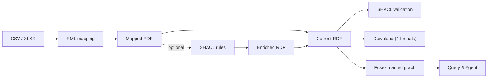
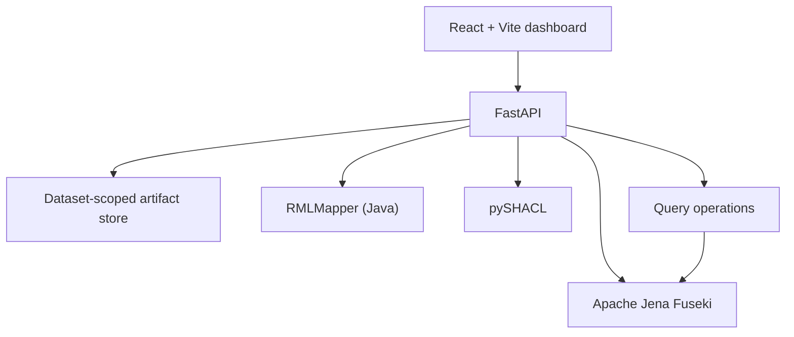

<div align="center">

# Semantic Data Studio

### Turn spreadsheets into a validated, queryable knowledge graph

[](https://react.dev/)
[](https://fastapi.tiangolo.com/)
[](https://www.w3.org/RDF/)
[](LICENSE)

A web dashboard for mapping CSV and Excel data to RDF, checking and enriching it with SHACL, publishing it to Apache Jena Fuseki, and querying the triple store.

</div>

---

## Overview

Semantic Data Studio is a business-friendly dashboard rather than a fixed pipeline. An **Overview** page summarises the active dataset (rows, RDF triples, data quality, published graph, and triple-store status), and a sidebar opens each workspace in any order:

| Workspace | What it does |
| --- | --- |
| **Data** | Upload a CSV or XLSX file and inspect a parsed preview, its columns, and the file name to use in the mapping. |
| **Mapping** | Provide an RML mapping (pasted or uploaded) and run RMLMapper to produce RDF. |
| **Data quality** | Provide SHACL shapes (pasted or uploaded); validate the data, including SPARQL-based constraints, and apply SHACL rules to add inferred triples. |
| **Knowledge graph** | Download the current RDF as Turtle, N-Triples, JSON-LD, or RDF/XML; publish it to a Fuseki named graph; browse it entity by entity. |
| **Query & Agent** | Query every graph in Fuseki directly — no upload needed — through ready-made operations or a SPARQL editor. |

The system is domain-independent. Uploaded data is stored in an isolated, dataset-scoped workspace on the server, and the browser remembers the active dataset across page reloads.



The **current RDF** is the enriched RDF when SHACL rules ran successfully, otherwise the mapped RDF. Validation, downloads, publishing, and the RDF browser all use it.

## Features

### Data
- Upload `.csv` or `.xlsx` files; Excel workbooks use the active worksheet.
- Multi-row Excel headings and separate date/time columns are combined during conversion to CSV for RMLMapper.
- See row and column counts, encoding or sheet name, and a preview table.
- Remove a dataset and every file generated from it.

### Mapping
- Paste an RML mapping into the editor or upload a Turtle file; an uploaded file can be switched to the editor for changes.
- The exact logical-source file name and all column names are shown next to the editor.
- Readable errors when the mapping is invalid or produces no triples, with the RMLMapper log available.

### Data quality (SHACL)
- Paste or upload one shapes graph that holds both constraints and rules.
- **Validate data** checks SHACL Core constraints and SPARQL-based constraints (`sh:sparql`) against the current RDF. Results appear as a table (severity, record, property, value, message, constraint) with severity filters and search; the full text report is downloadable.
- **Apply rules** runs `sh:TripleRule` and `sh:SPARQLRule` once, in `sh:order`, over the mapped RDF and stores the result as enriched RDF. Validation ignores rules, so apply them first when constraints depend on inferred facts.
- Non-conformance is a result, not a failure: every other workspace stays available.

### Knowledge graph
- Download the current RDF as Turtle, N-Triples, JSON-LD, or RDF/XML.
- Publish to a Fuseki named graph given as a short name or full IRI, either **replacing** the graph's content or **adding** to it.
- Browse the RDF ten entities at a time.

### Query & Agent
- Lists every named graph in Fuseki with its triple count; works without uploading a dataset.
- **Operations**: reusable, parameterised, read-only queries — graph overview, entity types, property usage, sample records, find entities by type, describe an entity, and text search. The generated SPARQL is shown and can be opened in the editor.
- **SPARQL editor** for free read-only queries (Ctrl+Enter runs), with results as a table, a yes/no answer, or RDF text, and CSV export.
- **Agent-ready**: the operations catalog is published at `GET /api/store/operations` with typed parameters, so an AI agent can register each operation as a tool and call `POST /api/store/operations/{id}`. Parameters are validated and escaped on the server.

## Architecture



| Path | Responsibility |
| --- | --- |
| `frontend/` | React dashboard: overview, workspaces, editors, previews, result tables, downloads |
| `pipeline/playground_server.py` | FastAPI endpoints, dataset lifecycle, error isolation, artifact delivery, serving the built UI |
| `pipeline/generic_pipeline.py` | Tabular parsing and XLSX conversion, RMLMapper execution, SHACL actions, RDF export, ingestion |
| `pipeline/run_store.py` | Dataset state and artifacts; re-running an action clears results derived from it |
| `SHACL/shacl_engine.py` | Structured SHACL validation and rule execution on pySHACL |
| `query_agent/operations.py` | Catalog of named, parameterised read-only SPARQL operations |
| `triple_store_ingestion/ingest.py` | Fuseki Graph Store Protocol and SPARQL query client |
| `run.py` | One-command launcher (production build or hot-reload development) |

## API surface

| Endpoint | Purpose |
| --- | --- |
| `GET /api/health` | Health check |
| `GET /api/config` | Fuseki connection and tool readiness |
| `POST /api/runs` | Create a dataset from a CSV or XLSX upload |
| `GET /api/runs/{id}` · `DELETE /api/runs/{id}` | Read or remove a dataset |
| `POST /api/runs/{id}/stages/rml` | Run an RML mapping (`mapping`, optional `source_name`) |
| `POST /api/runs/{id}/stages/shacl` | Validate the current RDF (`shapes`, optional `source_name`) |
| `POST /api/runs/{id}/stages/shacl-rules` | Apply SHACL rules and create enriched RDF |
| `POST /api/runs/{id}/stages/ingest` | Publish to a named graph (`graph_name`, `mode`: `replace` or `append`) |
| `GET /api/runs/{id}/rdf?format=` | Download the current RDF (`turtle`, `ntriples`, `jsonld`, `xml`) |
| `GET /api/runs/{id}/rdf-preview` | Page through the current RDF by entity |
| `GET /api/runs/{id}/artifacts/{artifact_id}` | Download a stored artifact (mapping, shapes, report) |
| `GET /api/store/graphs` | Named graphs in Fuseki with triple counts |
| `POST /api/store/query` | Run a read-only SPARQL query |
| `GET /api/store/operations` | Catalog of query operations and their parameters |
| `POST /api/store/operations/{id}` | Run an operation (`parameters` object) |

Interactive documentation is available at `/docs` while the backend runs.

## Installation

### Prerequisites

- **Python 3.10 or newer** for the backend.
- **Node.js and npm** for building the frontend.
- **Java** for RMLMapper (RMLMapper 8.x needs Java 21 or newer).
- **RMLMapper** JAR.
- **Apache Jena Fuseki** for publishing and querying.

### 1. Install the backend dependencies

From the repository root:

```bash
pip install -r requirements.txt
```

A virtual environment (`python3 -m venv .venv` then `source .venv/bin/activate`, or `.\.venv\Scripts\Activate.ps1` on Windows) keeps these packages separate from other projects.

### 2. Add RMLMapper

Download the `-all.jar` asset from the [RMLMapper releases](https://github.com/RMLio/rmlmapper-java/releases), rename it, and place it at:

```text
pipeline/rmlmapper.jar
```

The JAR is excluded from Git. To keep it elsewhere, set `RML_MAPPER_JAR` to its path. The sidebar shows whether the backend finds it.

### 3. Start Apache Jena Fuseki

Download `apache-jena-fuseki-<version>.zip` from the [Jena download page](https://jena.apache.org/download/) (not the `apache-jena` tools archive), unpack it, and start it with a dataset named `dataset`:

```bash
./fuseki-server --update --mem /dataset          # macOS / Linux
.\fuseki-server.bat --update --mem /dataset      # Windows
```

The in-memory dataset is erased when Fuseki stops. For persistent storage, use `--tdb2 --loc=databases/dataset /dataset` instead of `--mem`. The backend expects:

```text
Graph Store endpoint: http://localhost:3030/dataset/data
SPARQL endpoint:      http://localhost:3030/dataset/query
```

Other deployments can be configured with `FUSEKI_DATA_URL` and `FUSEKI_QUERY_URL`.

## Running the application

With Fuseki running, from the repository root:

```bash
python run.py
```

This builds the frontend when its sources have changed (running `npm install` the first time) and serves the dashboard and API together at `http://localhost:8000`. Options: `--host 0.0.0.0` to expose it on the network, `--port` to change the port, `--rebuild` to force a fresh build.

For development with hot reload of the backend and the frontend:

```bash
python run.py --dev
```

This starts uvicorn with `--reload` on port 8000 and the Vite dev server on `http://localhost:5173`, which proxies `/api` to the backend. Ctrl+C stops both.

### Running the processes manually

```bash
python -m uvicorn pipeline.playground_server:app --reload --port 8000   # backend
cd frontend && npm run dev                                                # frontend
```

### Configuration

| Variable | Default | Purpose |
| --- | --- | --- |
| `FUSEKI_DATA_URL` | `http://localhost:3030/dataset/data` | Fuseki Graph Store endpoint |
| `FUSEKI_QUERY_URL` | derived from the data URL | Fuseki SPARQL query endpoint |
| `FUSEKI_GRAPH_BASE` | `https://example.org/graphs/` | Base IRI for short graph names |
| `RML_MAPPER_JAR` | `pipeline/rmlmapper.jar` | RMLMapper location |
| `PIPELINE_STORAGE_DIR` | system temp folder | Where dataset workspaces are stored |
| `MAX_UPLOAD_BYTES` | 50 MB | Upload size limit |
| `PIPELINE_COMMAND_TIMEOUT` | 300 | RMLMapper time limit in seconds |
| `SPARQL_RESULT_ROW_LIMIT` | 1000 | Maximum rows returned per query |

## Trying it with `test-data`

- `sample.xlsx` and `waterinfo.csv` are uploadable sources.
- `rml.ttl.txt` is an example RML mapping. Change its `rml:source` from `data.csv` to the file name shown in the dashboard (`waterinfo.csv`, or `sample.csv` for the workbook).
- `SHACL_in.ttl` is an example shapes file for the mapped observations.
- `mapped.ttl` and `query.txt` are reference outputs.

## Mapping constraints

The file name in `rml:source` must exactly match the prepared CSV name shown in the dashboard. Uploading `sample.xlsx` produces `sample.csv`:

```turtle
rml:logicalSource [
    rml:source "sample.csv" ;
    rml:referenceFormulation ql:CSV
] ;
```

Do not use an absolute path; RMLMapper runs inside the dataset's isolated directory. Column names in `rr:template` and `rml:reference` must match the CSV headers exactly.

## Performance notes

pySHACL evaluates SPARQL-based constraints and rules once per target record, so they dominate run time on large datasets (roughly a few seconds per thousand targeted records). SHACL Core constraints are much faster. RDF is held in memory while it is processed.

## Tests

```bash
python -m pytest pipeline/tests
```

Integration tests that run RMLMapper are skipped when Java or `pipeline/rmlmapper.jar` is missing.

## License

This project is available under the [MIT License](LICENSE).
