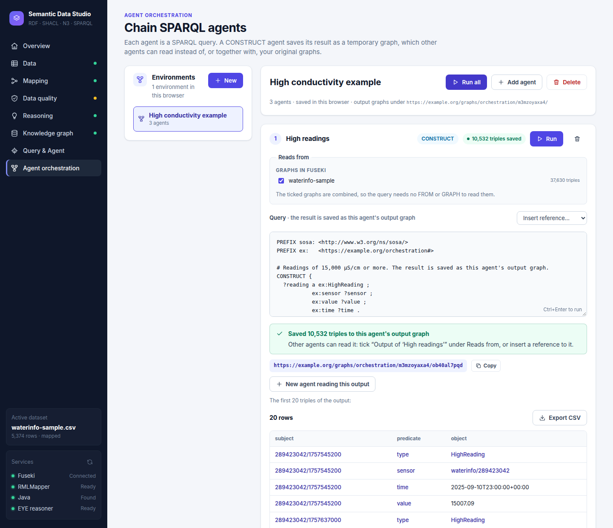
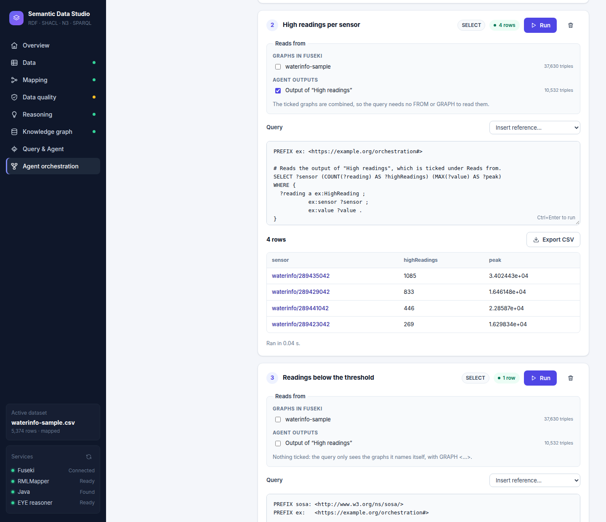

# Agent orchestration

The **Agent orchestration** workspace chains SPARQL queries. Each query is an **agent**. A CONSTRUCT agent saves its result as a temporary graph, and other agents can read that graph instead of, or together with, your original graphs. You never type the name of a temporary graph: you tick it in a list or insert a reference to it.



**Contents:** [Concepts](#concepts) · [Getting started](#getting-started) · [Choosing what an agent reads](#choosing-what-an-agent-reads) · [Keeping agents up to date](#keeping-agents-up-to-date) · [The example environment](#the-example-environment) · [Where things are stored](#where-things-are-stored) · [Limits](#limits) · [API](#api) · [Troubleshooting](#troubleshooting)

## Concepts

- **Environment:** a workspace that holds agents. Environments are saved in your browser.
- **Agent:** a name, a SPARQL query, and the graphs it **reads from**.
- **Output graph:** when an agent runs a CONSTRUCT or DESCRIBE query, its result is saved in Fuseki as that agent's output graph, replacing what the previous run saved. The graph is named after the environment and the agent: `https://example.org/graphs/orchestration/<environment>/<agent>`. SELECT and ASK results are shown on the agent, not saved.

## Getting started

1. Publish at least one graph to Fuseki, for example the sample data (**Knowledge graph** → **Publish**).
2. Open **Agent orchestration** and press **New** to create an environment. Click its name to rename it.
3. Click **Add agent**, give the agent a name, choose what it reads from, write a query, and click **Run** (or press Ctrl+Enter in the editor).
4. After a CONSTRUCT agent has run, click **New agent reading this output** to start an agent that builds on it.

To see everything working at once, press **Try an example** (or **Load the example environment**) and then **Run all**.

## Choosing what an agent reads

### Reads from: tick the graphs

Every agent has a **Reads from** list with tick boxes. It shows the graphs in Fuseki and the outputs of the other agents in the environment, labelled by agent name. The ticked graphs are combined, so the query can match their triples directly, without `FROM` or `GRAPH`:

```sparql
# Reads from: [x] Output of "High readings"
PREFIX ex: <https://example.org/orchestration#>
SELECT ?sensor (COUNT(?reading) AS ?highReadings)
WHERE { ?reading a ex:HighReading ; ex:sensor ?sensor }
GROUP BY ?sensor
```

Tick several graphs to combine them, for example an agent's output and the original data.

Behind the scenes, the app passes the ticked graphs to Fuseki as the query's default graph (`default-graph-uri` in the SPARQL protocol). It also passes every graph in the store as a named graph, so `GRAPH <…>` blocks in the same query still work.

### Insert reference: name a graph in the query

Some queries need to treat two graphs separately, for example "readings in the original data that are **not** in an agent's output". Combining the graphs cannot express that, so the query names each one. Pick a graph from **Insert reference** above the editor:

- an agent output is inserted as a short reference, such as `<agent:high-readings>`;
- a graph in Fuseki is inserted with its full name.

```sparql
SELECT (COUNT(?reading) AS ?below)
WHERE {
  GRAPH <https://example.org/graphs/waterinfo-sample> { ?reading a sosa:Observation }
  FILTER NOT EXISTS { GRAPH <agent:high-readings> { ?reading a ex:HighReading } }
}
```

When the agent runs, `<agent:high-readings>` is replaced by the real name of that agent's output graph. The reference is made from the agent's name; if you rename the agent, the references to it are updated in every query of the environment.

When nothing is ticked under **Reads from**, a query only sees the graphs it names itself, because Fuseki's default graph is empty.

## Keeping agents up to date

Each agent shows its status next to its name:

| Status | Meaning |
| --- | --- |
| **Not run** | The agent has not run yet. |
| **4 rows**, **Yes**, **10,532 triples saved** | The last run succeeded. |
| **Failed** | The last run failed. The message on the agent says why, often Fuseki's own error. |
| **Unknown reference** | The query uses an `<agent:…>` reference that matches no agent here. |
| **Waiting for input** | The agent reads an output that does not exist yet. Run that agent first, or use **Run all**. |
| **Stale** | An agent it reads from ran again after it. Run it again to use the new output. |
| **Edited** | Its query or its sources changed after the last run. |

- **Run all** runs every agent in an order where each agent runs after the agents it reads from, and stops at the first failure.
- An agent cannot read from an agent that reads from it, directly or through other agents. Such outputs are greyed out in **Reads from**, so the chain never loops.

## The example environment

**Try an example** creates three agents for the sample water data (`test-data/waterinfo-sample.csv`, published as a graph). With **Run all**:

| Agent | Reads | Query | Result on the sample |
| --- | --- | --- | --- |
| **High readings** | the published graph (ticked) | CONSTRUCT readings of 15,000 µS/cm or more | 10,532 triples saved |
| **High readings per sensor** | the output of **High readings** (ticked) | SELECT the number and peak of high readings per sensor | 4 rows |
| **Readings below the threshold** | nothing ticked; references both graphs | SELECT the readings in the published graph that are not in the output | 2,741 readings |



## Where things are stored

- **Environments and agents** are saved in this browser (`localStorage`). They are not shared with other browsers or people, and clearing the site data removes them. Result tables are not saved, only each agent's status and when it last ran.
- **Output graphs** are saved in Fuseki. Fuseki started with `--mem` loses them when it stops; the agents then show **Output graph not found**, and **Run all** rebuilds them.
- **Deleting** an agent or an environment removes its output graphs from Fuseki.
- **Query & Agent** lists the output graphs under **Agent outputs (temporary)**, so you can inspect them there too.
- **Your published graphs are safe.** Agent queries go to Fuseki's read-only query endpoint, and the app only writes inside the `orchestration/` namespace.

## Limits

- SELECT results show at most `SPARQL_RESULT_ROW_LIMIT` rows (1,000 by default). CONSTRUCT outputs are saved in full; the agent previews the first 20 triples.
- An agent can read from at most 50 ticked graphs.
- Every query must finish within `PIPELINE_COMMAND_TIMEOUT` seconds (300 by default).
- When graphs are ticked, `GRAPH` blocks can reach up to `SPARQL_RESULT_ROW_LIMIT` named graphs.
- The output graphs follow `FUSEKI_GRAPH_BASE` (`https://example.org/graphs/` by default).

## API

The dashboard runs agents through the API, so scripts and AI agents can do the same:

```bash
curl -X POST http://localhost:8000/api/orchestration/run \
  -H "Content-Type: application/json" \
  -d '{
        "environment_id": "demo123",
        "agent_id": "high123",
        "query": "PREFIX sosa: <http://www.w3.org/ns/sosa/> CONSTRUCT { ?r a <https://example.org/High> } WHERE { ?r sosa:hasSimpleResult ?v FILTER(?v >= 15000) }",
        "sources": ["https://example.org/graphs/waterinfo-sample"]
      }'
```

- `environment_id` and `agent_id` are 6 to 32 lowercase letters or digits. They decide the output graph: `…/orchestration/demo123/high123`.
- `sources` are the graphs the query reads from. Leave the list empty to let the query name its graphs.
- The API does not know `<agent:…>` references; send real graph names.
- The response is a SELECT table (`type: "select"`), an ASK answer (`type: "ask"`), or, for CONSTRUCT and DESCRIBE, `type: "graph"` with `triples`, `output_graph`, and a `preview`.

`DELETE /api/orchestration/environments/<environment_id>/outputs` removes an environment's output graphs. Add `?agent_id=<agent_id>` to remove one agent's output.

## Troubleshooting

<details>
<summary><b>"Waiting for input"</b></summary>

The agent reads the output of an agent that has not produced an output yet. Run that agent first, or use **Run all**.
</details>

<details>
<summary><b>"Unknown reference"</b></summary>

The query contains an `<agent:…>` reference that matches no agent in this environment, for example because that agent was deleted. Use **Insert reference** to pick an existing agent.
</details>

<details>
<summary><b>"Output graph not found"</b></summary>

The agent's output is no longer in Fuseki, usually because Fuseki was restarted with `--mem`. Run the agent again, or use **Run all**.
</details>

<details>
<summary><b>A query matches nothing</b></summary>

Check **Reads from**. With nothing ticked, the query only sees graphs it names with `GRAPH <…>`. With graphs ticked, check that the query uses the same IRIs as the data, for example by running `SELECT * WHERE { ?s ?p ?o } LIMIT 10` in the same agent.
</details>
