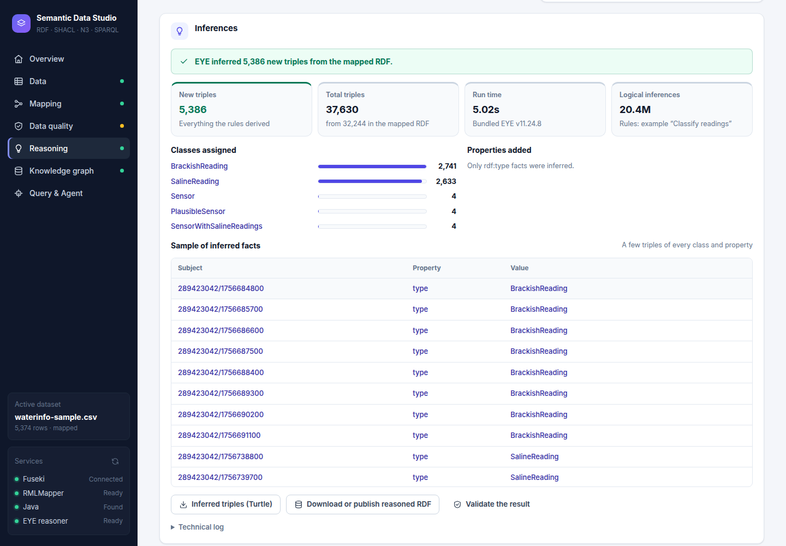
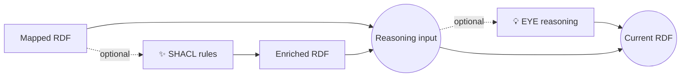
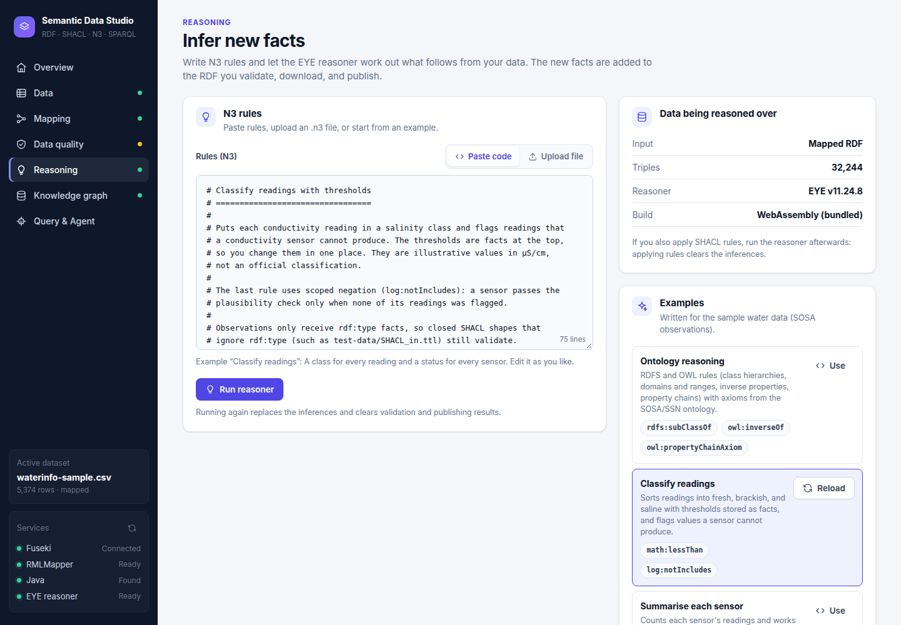

# Reasoning with EYE

The **Reasoning** workspace applies [Notation3 (N3)](https://w3c.github.io/N3/spec/) rules to your RDF with the [EYE reasoner](https://eyereasoner.github.io/eye/) and adds the facts they imply to your data. You can then validate, download, publish, and query those facts like any other triple.



**Contents:** [Where reasoning fits](#where-reasoning-fits) · [Using the workspace](#using-the-workspace) · [Examples](#examples) · [Writing rules](#writing-rules) · [What is added to your data](#what-is-added-to-your-data) · [Validating inferred facts](#validating-inferred-facts) · [Bundled or native EYE](#bundled-or-native-eye) · [Performance](#performance) · [Troubleshooting](#troubleshooting) · [API](#api)

## Where reasoning fits



- EYE reasons over the **enriched RDF** when SHACL rules have run, and over the **mapped RDF** otherwise.
- After a successful run, the **reasoned RDF** (the input plus every new triple) becomes the current RDF. Validation, downloads, publishing, the RDF browser, and the Overview all use it.
- Running the mapping or the SHACL rules again clears the reasoning result, because its input changed. Run the reasoner again afterwards.
- Running the reasoner again clears earlier validation and publishing results, because the current RDF changed.
- If a run fails, the RDF from before the run stays the current RDF.

## Using the workspace

1. Map your data to RDF first (**Mapping**).
2. Open **Reasoning** and provide N3 rules in one of three ways:
   - **Paste code:** type or paste rules into the editor.
   - **Upload file:** an `.n3`, `.ttl`, or `.txt` file of up to 2 MB.
   - **Examples:** click **Use** next to an example to load it into the editor. You can edit it before running it.
3. Click **Run reasoner**.
4. Review the result:
   - **New triples**, **Total triples**, **Run time**, and **Logical inferences** (EYE's own count of inference steps).
   - **Classes assigned** and **Properties added**, with how many triples each one got.
   - **Sample of inferred facts**: a few triples of every class and property.
   - **Inferred triples (Turtle)** downloads only the new triples. **Technical log** shows EYE's own output.
5. Carry on with **Data quality** to validate the result, **Knowledge graph** to download or publish it, or **Query & Agent** to query it once it is published.



The **Services** panel in the sidebar shows **EYE reasoner: Ready** when EYE can run. Hover over it to see the EYE version and which build is used.

## Examples

The examples live in [`reasoning/examples/`](../reasoning/examples). They are written for the sample water-quality data: SOSA observations of electrical conductivity in µS/cm. The numbers below are for [`test-data/waterinfo-sample.csv`](../test-data/waterinfo-sample.csv) mapped with [`test-data/rml.ttl.txt`](../test-data/rml.ttl.txt), which gives 32,244 triples.

| Example | What it shows | What it adds on the sample |
| --- | --- | --- |
| **Ontology reasoning**<br>[`ontology-reasoning.n3`](../reasoning/examples/ontology-reasoning.n3) | Generic RDFS and OWL rules: class and property hierarchies, domains and ranges, inverse, symmetric, and transitive properties, and property chains. The axioms come from the SOSA/SSN ontology. | 5,388 triples: every sensor's observations (`sosa:madeObservation`), sensor and property types, and what each sensor observes (`sosa:observes`). |
| **Classify readings**<br>[`salinity-classes.n3`](../reasoning/examples/salinity-classes.n3) | Thresholds stored as facts, numeric comparisons, and scoped negation (`log:notIncludes`). | 5,386 triples: 2,741 brackish and 2,633 saline readings, and a status for each of the 4 sensors. |
| **Summarise each sensor**<br>[`sensor-summary.n3`](../reasoning/examples/sensor-summary.n3) | Aggregation with `log:collectAllIn`, and the `list:` and `math:` built-ins. | 28 triples: the reading count, minimum, maximum, mean, and first and last reading time of each sensor. |
| **Detect sudden changes**<br>[`sudden-changes.n3`](../reasoning/examples/sudden-changes.n3) | Date-time arithmetic, joins on computed values, and `log:query`. | 122 triples: 61 readings that changed by more than 4,000 µS/cm within 15 minutes, with the size of each change. |

The thresholds in **Classify readings** and **Detect sudden changes** are illustrative. Change them in the facts at the top of each file.

To use an example with your own data, replace the IRIs with the ones your mapping produces. The rules in **Ontology reasoning** are generic: replace its axioms with your own ontology and they apply as they are.

## Writing rules

A rule says: whenever the pattern in the first braces matches your data, the pattern in the second braces is true as well.

```n3
@prefix ex: <https://example.org/> .

# Every lamp is a light that illuminates.
{ ?x a ex:Lamp } => { ?x a ex:Light ; ex:illuminates true } .
```

- Variables start with `?`. Use exactly the IRIs your data uses. You can look them up under **Knowledge graph**, in **Browse RDF**.
- Rules build on each other's conclusions. EYE keeps applying them until nothing new follows.
- Facts written in the rules document, such as thresholds or ontology axioms, are used while reasoning but are **not** added to your data. Only what the rules derive is added.
- A rule with the conclusion `false` is an **inference fuse**: `{ ?x ex:age ?a . ?a math:lessThan 0 } => false .` stops the run with an error when the data matches. Use it for hard constraints.
- A rule that creates a new blank node every time it fires, and then fires on its own output, never finishes. The run stops after `PIPELINE_COMMAND_TIMEOUT` seconds (300 by default).

### Built-ins used in the examples

| Built-in | Example | Meaning |
| --- | --- | --- |
| `math:greaterThan`, `math:lessThan`, `math:notGreaterThan`, `math:notLessThan` | `?value math:lessThan 1500` | Compare numbers. |
| `math:sum`, `math:difference`, `math:product`, `math:quotient` | `( ?total ?count ) math:quotient ?mean` | Arithmetic. The subject is a list of numbers. |
| `math:difference` on date-times | `( ?time "1970-01-01T00:00:00Z"^^xsd:dateTime ) math:difference ?seconds` | The difference between two date-times, in seconds. |
| `math:rounded`, `math:absoluteValue`, `math:min`, `math:max` | `?values math:max ?maximum` | Rounding, absolute value, and the smallest or largest number in a list. |
| `list:length`, `list:sort`, `list:first`, `list:last` | `?times list:sort ?sorted` | Work with lists. |
| `log:collectAllIn` | `( ?v { ?r sosa:hasSimpleResult ?v } ?values ) log:collectAllIn _:scope` | Collect every match of a pattern into a list. |
| `log:notIncludes` | `?scope log:notIncludes { ?r a wq:ImplausibleReading }` | True when the pattern has no match: negation as failure, scoped to everything known at that point. |
| `log:rawType` | `?y log:rawType log:Other` | The kind of a term. `log:Literal` for literals, `log:Other` for IRIs and blank nodes. |

EYE supports many more built-ins. See the [N3 built-ins report](https://w3c.github.io/N3/reports/20230703/builtins.html) and [Notation3 by example](https://github.com/eyereasoner/Notation3-By-Example).

### Rules that stay fast on large data

Two things made a large difference in our measurements:

- **Start a premise from your data, not from a class that other rules derive in bulk.** In **Classify readings**, `{ ?reading sosa:madeBySensor ?sensor . ?reading a wq:SalineReading }` runs about ten times faster on the full sample file than the same patterns in the opposite order.
- **Use a fixed predicate in the conclusion.** `{ ?o sosa:madeBySensor ?s } => { ?s sosa:madeObservation ?o }` took 2.9 seconds on 120,000 triples. The generic `{ ?p owl:inverseOf ?q . ?x ?p ?y } => { ?y ?q ?x }`, which has a variable as the predicate of its conclusion, took 26.5 seconds for the same result, and the gap grows with the data. A variable predicate in the premise is not a problem.

## What is added to your data

- **By default, every new triple.** EYE runs with `--pass-only-new`, and the triples it derives are merged into the input.
- **With a `log:query`, only its answers.** When the rules contain a statement of the form `{ pattern } log:query { template } .`, EYE outputs only the query's answers, and only those are added. This keeps helper facts out of your data: [`sudden-changes.n3`](../reasoning/examples/sudden-changes.n3) uses epoch seconds and links to the previous reading while reasoning, but adds only the flags. The result shows **Answers to the log:query** under **New triples**.
- **N3-only statements are left out.** Triples that contain a formula or a variable, or that have a literal as subject, are valid N3 but not RDF. They are skipped, and the result says how many there were.
- **Blank nodes keep their identity.** Blank nodes in your data are handed to EYE as IRIs and turned back into the same blank nodes afterwards, so facts derived about them connect to the original nodes.

Each run stores three files: the **N3 rules**, the **Inferred triples**, and the **Reasoned RDF**.

## Validating inferred facts

Validation runs on the reasoned RDF, so SHACL shapes can target classes that EYE inferred. For example, after **Classify readings**:

```turtle
@prefix sh:   <http://www.w3.org/ns/shacl#> .
@prefix sosa: <http://www.w3.org/ns/sosa/> .
@prefix wq:   <http://example.com/water-quality#> .

wq:SalineReadingShape a sh:NodeShape ;
    sh:targetClass wq:SalineReading ;
    sh:property [
        sh:path sosa:hasSimpleResult ;
        sh:maxExclusive 15000 ;
        sh:severity sh:Warning ;
        sh:message "Saline water (15,000 µS/cm or more): review this reading." ;
    ] .
```

On the sample, this gives one warning for each of the 2,633 saline readings.

> [!NOTE]
> [`test-data/SHACL_in.ttl`](../test-data/SHACL_in.ttl) **closes** the shape for observations (`sh:closed true`): apart from `rdf:type`, an observation may only have the properties the shape lists. **Ontology reasoning**, **Classify readings**, and **Summarise each sensor** keep the sample valid, because they add only `rdf:type` facts to observations and describe the sensors otherwise. **Detect sudden changes** adds `wq:changeFromPrevious` to observations, so the closed shape reports one violation per flagged reading. To allow it, add `wq:changeFromPrevious` to `sh:ignoredProperties` or give it a property shape.

## Bundled or native EYE

|  | Bundled (default) | Native |
| --- | --- | --- |
| What it is | The WebAssembly build of EYE from the npm package [`eyereasoner`](https://www.npmjs.com/package/eyereasoner) (EYE v11.24.8), run with Node.js | EYE on a local SWI-Prolog installation |
| How to install | Nothing to do: `python run.py` installs it into `reasoning/node_modules` on first start | Install SWI-Prolog, then EYE (see below) |
| Best for | Demos and datasets of up to a few hundred thousand triples | Large datasets |

The app picks the first one that is available:

1. the command in the `EYE_COMMAND` environment variable,
2. `eye` on your `PATH`,
3. the bundled build (needs `node` on your `PATH` and `reasoning/node_modules`).

Both builds take the same arguments, and the app treats them the same way. The bundled build runs inside WebAssembly, so it is slower and can use at most the memory WebAssembly allows.

### Installing native EYE

1. Install [SWI-Prolog](https://www.swi-prolog.org/Download.html) and check it with `swipl --version`.
   On macOS: `brew install swi-prolog`. On Ubuntu: `sudo apt install swi-prolog`. On Windows: use the installer.
2. Download `eye.zip` from the [EYE releases](https://github.com/eyereasoner/eye/releases) and unzip it.
3. Run the installation script in the unzipped folder.

   **macOS / Linux**, to install into your home folder:

   ```bash
   ./install.sh --prefix=$HOME/.local
   ```

   This creates `$HOME/.local/bin/eye`. Make sure `$HOME/.local/bin` is on your `PATH`.

   **Windows**: run `install.cmd`, then add `C:\Program Files\eye\bin` to your `PATH`.

4. Check it with `eye --version`, then restart `python run.py`. The Services panel then shows the native build.

To use an `eye` that is not on your `PATH`, set `EYE_COMMAND` to its full path, for example `EYE_COMMAND=/opt/eye/bin/eye python run.py`.

## Performance

The app writes the input as N-Triples files of at most 100,000 triples each and has EYE read them with its `--turtle` parser, which is about ten times faster than its N3 parser. The run time shown in the result covers the whole run: loading the input, reasoning, and writing the reasoned RDF.

Measured with the bundled build on the development machine, on `waterinfo-sample.csv` (32,244 triples):

| Example | Run time |
| --- | ---: |
| Ontology reasoning | 5.5 s |
| Classify readings | 5.0 s |
| Summarise each sensor | 2.7 s |
| Detect sudden changes | 3.6 s |

On the full `waterinfo.csv` (837,870 triples), **Classify readings** takes 80 seconds, 38 of them in EYE. **Ontology reasoning** had not finished after 7 minutes, because its generic OWL rules have a variable as the predicate of their conclusion (see [Rules that stay fast on large data](#rules-that-stay-fast-on-large-data)). For large datasets, install native EYE and write rules for your specific properties.

## Troubleshooting

<details>
<summary><b>The EYE reasoner shows "Missing"</b></summary>

The bundled build needs Node.js and the npm package in `reasoning/node_modules`. Start the app with `python run.py`, which installs it, or run `npm ci` in the `reasoning` folder yourself. Then click the refresh icon in the Services panel. Hover over "Missing" to see the reason. If you set `EYE_COMMAND`, check that it points to a working `eye`.
</details>

<details>
<summary><b>"EYE could not parse the N3 rules: there is a syntax error after line N."</b></summary>

EYE reports the last line it could read. Check the line after it for a missing `.`, an unclosed `{` or `"`, or an undeclared prefix. The **Technical log** has EYE's own message.
</details>

<details>
<summary><b>"An inference fuse fired"</b></summary>

A rule with the conclusion `false` matched your data, so the data contradicts the rules. The **Technical log** shows the rule and the facts involved.
</details>

<details>
<summary><b>"Nothing new was inferred"</b></summary>

The rules ran but did not match anything. Usually the rules use other IRIs than the data: compare them with **Browse RDF** under **Knowledge graph**. A `log:query` that matches nothing gives the same result.
</details>

<details>
<summary><b>"No N3 rules found"</b></summary>

The document has no rule (`=>` or `<=`) and no `log:query`. Commented-out rules do not count.
</details>

<details>
<summary><b>"EYE ran out of memory" or "EYE did not finish within 300 seconds"</b></summary>

The data or the rules are too large for the bundled build. Install native EYE, reduce the data, or simplify the rules. To allow longer runs, set `PIPELINE_COMMAND_TIMEOUT` (in seconds). A run that never finishes usually has a rule that keeps creating new blank nodes.
</details>

## API

Reasoning is available through the API like the other operations.

```bash
# The example rule sets, with their N3 text
curl http://localhost:8000/api/reasoning/examples

# Run rules on a dataset (the dataset must be mapped first)
curl -X POST http://localhost:8000/api/runs/<run-id>/stages/reasoning \
  -H "Content-Type: application/json" \
  -d '{"rules": "@prefix sosa: <http://www.w3.org/ns/sosa/> . { ?o sosa:madeBySensor ?s } => { ?s a sosa:Sensor } ."}'
```

The request also takes `source_name` (the name of an uploaded rules file) and `example_id` (the example the rules came from). Both only label the result. The response is the dataset's state. Its `stages.reasoning.details` has `inferred_triples`, `total_triples`, `output_mode` (`derivations` or `query`), `engine`, `eye_version`, `eye_stats`, `summary` (classes, properties, and sample), and `duration_seconds`. Download the current RDF, which is now the reasoned RDF, with `GET /api/runs/<run-id>/rdf`.
